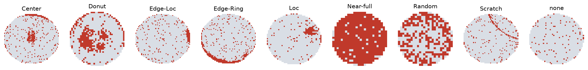
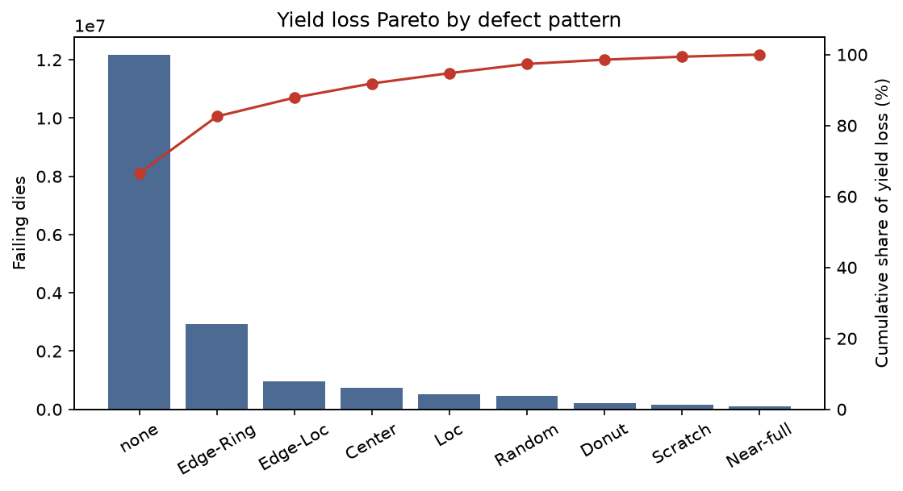
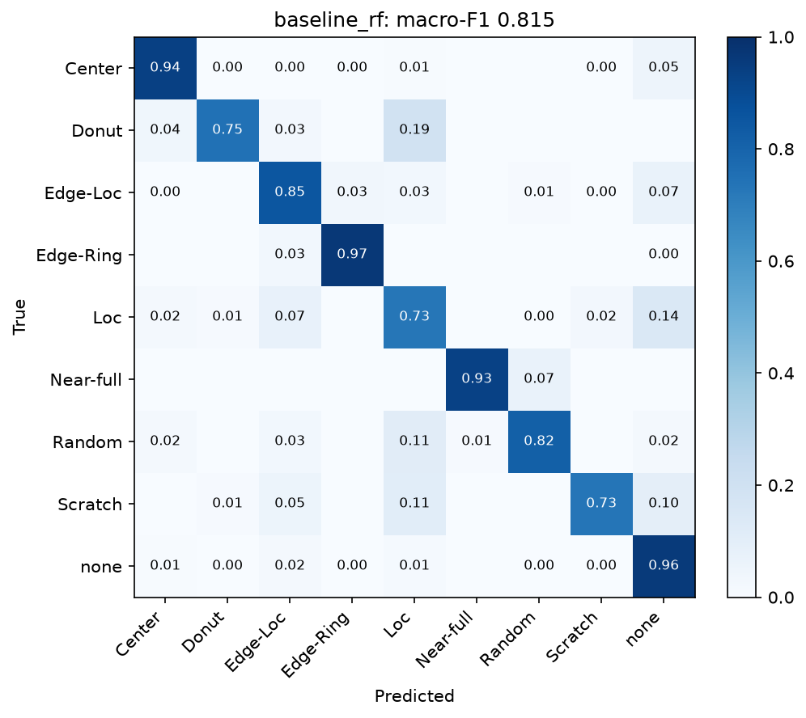
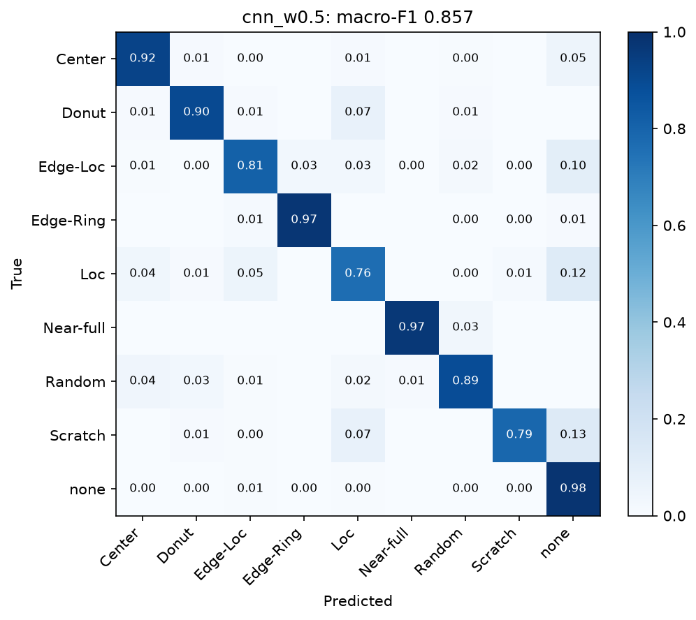

# 晶圆图良率分析 (wafer-map-yield)

用晶圆 bin map 回答三个问题:

1. **良率损失在哪里?** 按中心/中环/边缘分区和径向分布定位失效 die。
2. **是系统性的还是随机的?** 用连通域把成团失效(系统性)和孤立失效(随机)分开,做缺陷模式 Pareto。
3. **哪些批次出了问题?** 同一 lot 内多片晶圆出现相同缺陷模式,即标记为 excursion。

另外用两种方法识别缺陷模式并对比:手工空间特征 + 随机森林(可解释),以及 CNN。

## 真实数据结果 (WM-811K)

数据:811,457 片晶圆、46,293 个 lot,其中 172,950 片有人工标注。以下分析只用有标注的部分。



**良率损失**

| 指标 | 数值 |
|---|---|
| 整体良率 | 89.8% |
| 系统性损失(5 个以上相连的失效 die) | 3.7% |
| 随机损失(孤立失效) | 6.5% |

- 66.5% 的失效 die 落在标注为 `none`(无明显图案)的晶圆上,也就是说大部分良率损失来自背景缺陷,不是可识别的图案。
- 在有图案的晶圆里,Edge-Ring 损失最大,占全部失效 die 的 16.0%;其次是 Edge-Loc 5.3%、Center 4.0%。
- 按 slot(1–25)统计的平均良率在 88.1%–88.4% 之间,没有 slot 效应。



**批次 excursion**

- 有 5 片以上标注晶圆的 lot 共 7,418 个,其中 913 个(12.3%)被标记为 excursion。
- 主导图案:Edge-Ring 405 个、Center 291 个、Edge-Loc 89 个、Loc 63 个。
- excursion lot 的平均良率是 79.7%,其他 lot 是 86.3%。

**缺陷模式分类**

按 lot 分组做 80/20 划分(同一 lot 的晶圆不会同时出现在训练集和测试集),测试集 34,601 片:

| 模型 | macro-F1 | accuracy |
|---|---|---|
| 随机森林(17 个空间特征) | 0.815 | 0.95 |
| CNN(类别权重强度 0.5,15 epochs) | 0.857 | 0.97 |

- 随机森林最弱的两类是 Loc(F1 0.61)和 Edge-Loc(F1 0.67),最重要的特征是最大失效团的径向位置。
- CNN 在这两类上提升最明显:Loc 0.75、Edge-Loc 0.79。它最弱的仍是 Loc 和 Scratch(都是 0.75)。

混淆矩阵按行归一化,每行是一个真实类别被预测成各类的比例:

| 随机森林 | CNN |
|---|---|
|  |  |

**类别权重对 CNN 的影响**

损失函数里每类的权重是(类别频率的倒数)^强度。CNN 从训练 lot 里再分出 20% 作验证集选最佳 epoch,测试集不参与调参。每组只跑了一个随机种子。

| 权重强度 | 验证集 macro-F1 | 测试集 macro-F1 | 宏平均精确率 | 宏平均召回率 |
|---|---|---|---|---|
| 0(不加权) | 0.865 | 0.853 | 0.88 | 0.83 |
| 0.5(平方根) | 0.863 | 0.857 | 0.83 | 0.89 |
| 1(完全按频率倒数) | 0.801 | 0.798 | 0.74 | 0.89 |

- 强度 1 时一片 Near-full 的权重约是一片 `none` 的 1000 倍,模型把大量 `none` 误判成稀有类,Scratch 的精确率只有 0.38。
- 强度 0 和 0.5 的 macro-F1 相差在单次运行的波动范围内。默认取 0.5,因为它对缺陷类的召回率更高(0.89 对 0.83),漏判缺陷图案的代价通常比误报大。
- 第一次未调参的运行(强度 1、固定学习率、12 epochs、无验证集)只有 0.659;加上余弦学习率衰减和验证集选 epoch 后,同样强度 1 是 0.798。

口径说明:

- "系统性 / 随机"是按连通域大小划分的近似,Random 类晶圆上失效很密,会连成团被算进系统性。
- 这份数据混合了多种产品(晶圆图尺寸从 3 到 300 不等),整体良率是所有产品合在一起的数。
- 没有用数据集自带的 Training/Test 划分。

## 快速开始

```bash
pip install -e ".[dev]"          # 基础依赖
pip install -e ".[cnn]"          # 可选:PyTorch,只有 CNN 需要
pytest                            # 6 项测试
python -m wafermap.synthetic --out data/synthetic.pkl --n-lots 80
python -m wafermap.report   --data data/synthetic.pkl --out reports
python -m wafermap.baseline --data data/synthetic.pkl --out reports
python -m wafermap.cnn      --data data/synthetic.pkl --out reports --epochs 30
```

## 换成真实数据 (WM-811K)

1. 在 Kaggle 搜索 `wm811k-wafer-map`,下载并解压出 `LSWMD.pkl`(约 2 GB),放到 `data/wm811k/LSWMD.pkl`。
2. 把上面命令里的 `--data` 换成 `data/wm811k/LSWMD.pkl`,`--out` 换成 `reports/wm811k`。想先快速试跑可以加 `--max-wafers 20000`。

注意:

- `LSWMD.pkl` 是 Python 2 时代的 pandas 写的 pickle,新版 pandas 读不了。`wafermap/data.py` 里有专门的读取器,只允许文件构造 numpy 对象。
- 811,457 片里只有 172,950 片有标注,本项目只用有标注的部分。
- 真实数据里 `none` 占绝大多数,`Near-full` 只有 149 片,所以评价指标用 macro-F1,不用 accuracy。
- 真实数据没有机台/工艺路径信息,所以这里的 excursion 分析只能做到"lot 内模式共性",做不了机台共性分析。

## 目录

| 文件 | 作用 |
|---|---|
| `wafermap/data.py` | 读取数据、统一字段、最近邻缩放 |
| `wafermap/synthetic.py` | 生成与 WM-811K 同结构的合成晶圆 |
| `wafermap/features.py` | 每片晶圆的空间特征(分区失效率、径向/扇区分布、连通域) |
| `wafermap/analysis.py` | 损失拆分、模式 Pareto、lot excursion、slot 良率 |
| `wafermap/baseline.py` | 随机森林基线 + 特征重要性 |
| `wafermap/cnn.py` | CNN 分类(类别加权、旋转翻转增强) |
| `wafermap/evaluate.py` | 两个模型共用的划分与评分 |
| `wafermap/report.py` | 一键生成 CSV 和图 |

## 合成数据

`wafermap/synthetic.py` 生成的合成晶圆只用于测试和在没有真实数据时跑通流程,图案很规整,分数不代表真实性能。

## 下一步可以加的内容

- 真实数据上的不平衡处理对比(类别加权 / 过采样 / 自编码器增强)
- 用 MixedWM38 做混合缺陷的多标签分类
- Poisson / 负二项良率模型,从良率反推缺陷密度 D0 和聚集因子 α
- Streamlit 看板:选 lot 查看晶圆图、Pareto、excursion 列表

## 简历写法模板

数字来自上面的真实数据结果:

- 基于 WM-811K(81 万片真实晶圆图,17.3 万片有标注)搭建良率分析流程,用分区失效率和连通域分析将 10.2% 的良率损失拆分为系统性 3.7% / 随机性 6.5%
- 设计 lot 内缺陷模式共性规则,从 7,418 个 lot 中识别出 913 个 excursion 批次,其平均良率比正常批次低 6.6 个百分点
- 对比 17 个可解释空间特征 + 随机森林与 CNN 两种缺陷模式分类方法,在 `none` 占 85% 的类别不平衡下,按 lot 分组划分的 macro-F1 分别为 0.815 和 0.857
- 通过对照实验定位 CNN 误报的原因是类别权重过强,把权重从频率倒数改为其平方根后,macro-F1 从 0.798 提升到 0.857,Scratch 精确率从 0.38 提升到 0.71
