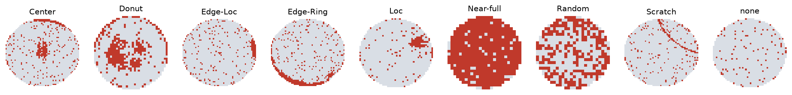
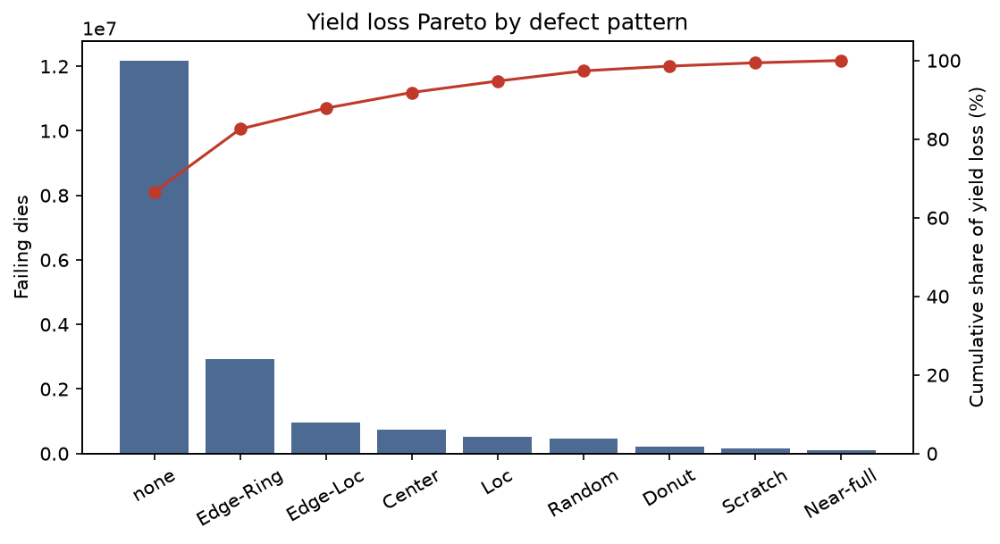
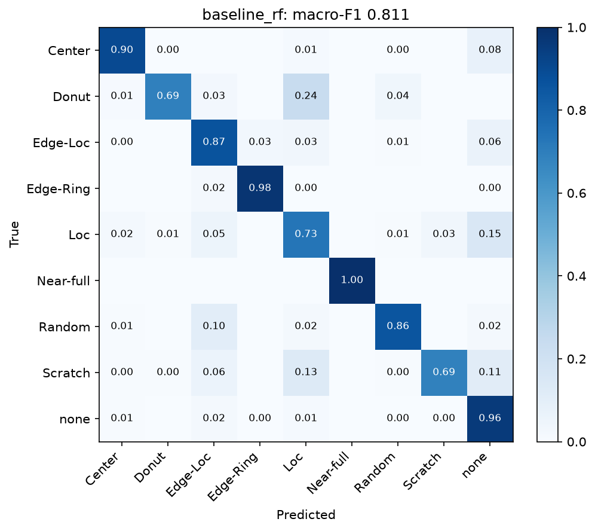
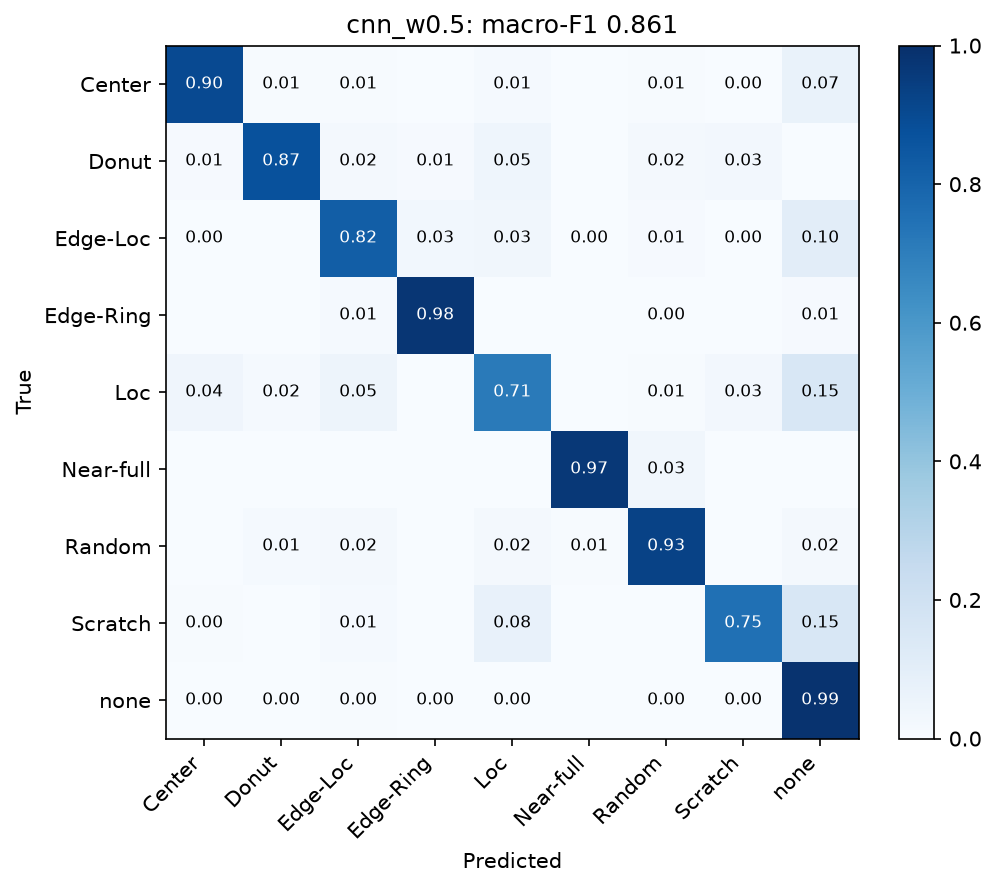
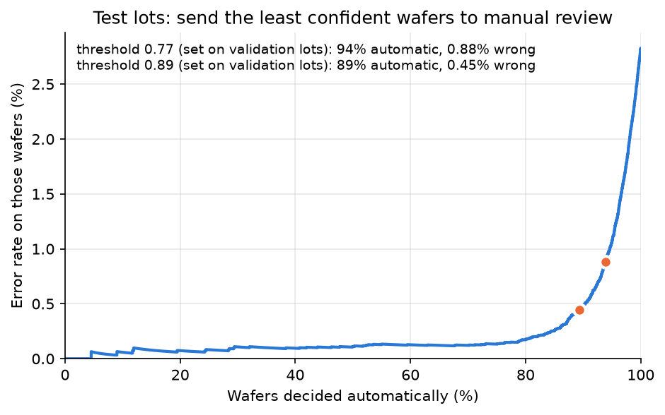

# 晶圆图良率分析 (wafer-map-yield)

[](https://github.com/litaoshu0727-del/wafer-map-yield/actions/workflows/tests.yml)

[English](README.md) | **中文**

**一句话**:用 81 万片真实晶圆的 bin map(WM-811K),定位良率损失、识别异常批次,并对比两种缺陷图案识别方法。

| 做了什么 | 结果 |
|---|---|
| 把 10.1% 的良率损失拆成系统性和随机两部分 | 按连通域规则是系统性 3.6%、随机 6.5%;用 join-count 检验复核后,其中 1.1 个百分点和巧合没有区别。边缘环状缺陷是最大的可识别损失来源 |
| 找出多片晶圆出现相同缺陷图案的异常批次 | 7,251 个批次里 746 个,平均良率 80.9%,其他批次 87.1% |
| 识别 9 类缺陷图案,按批次划分数据,5 个随机种子 | 随机森林 macro-F1 0.804,CNN 0.854 |
| 低置信度的晶圆转人工复判 | 90% 自动判定,错误率 0.45%(全部自动判定时 2.8%) |
| 用合成的机台路径检验共性分析方法(真实数据没有机台记录) | excursion 有 88% 集中在 3 段连续批次里;机台连续跑货时,逐批次的 Fisher 检验 100% 误报,改用循环平移校准后误报不超过 7% |
| 逐片对比晶圆图,检查数据质量 | 发现约 26% 的批次是同一批晶圆的重复记录,数据集文档没有说明 |

另有两个否定的结论:自监督预训练和伪标签都没有超过把有标注数据训练充分的模型。下面是主要结果,详细的实验放在 `docs/` 下(见[更多分析](#更多分析))。



用晶圆 bin map 回答三个问题:

1. **良率损失在哪里?** 按中心/中环/边缘分区和径向分布定位失效 die。
2. **是系统性的还是随机的?** 用连通域把成团失效(系统性)和孤立失效(随机)分开,做缺陷模式 Pareto。
3. **哪些批次出了问题?** 同一 lot 内多片晶圆出现相同缺陷模式,即标记为 excursion。

另外用两种方法识别缺陷模式并对比:手工空间特征 + 随机森林(可解释),以及 CNN。CNN 部分还包括多种子统计、Grad-CAM、按置信度转人工、高置信度错例复查、两种利用未标注数据的尝试(自监督预训练和伪标签,都没有超过充分训练的有监督模型),以及混合缺陷的多标签分类。训练好的 CNN 导出后,在 [yield-dashboard](https://github.com/litaoshu0727-del/yield-dashboard) 项目里给所有晶圆打上缺陷模式。

## 真实数据结果 (WM-811K)

数据:811,457 片晶圆、46,293 个 lot,其中 172,950 片有人工标注。以下分析只用有标注的部分,并去掉了重复记录(见[数据质量](docs/data-quality.md)),剩 170,684 片。

**良率损失**

| 指标 | 数值 |
|---|---|
| 整体良率 | 89.9% |
| 系统性损失(5 个以上相连的失效 die) | 3.6%(偏高,见 [join-count 检验](docs/spatial-test.md)) |
| 随机损失(孤立失效) | 6.5% |

- 67.8% 的失效 die 落在标注为 `none`(无明显图案)的晶圆上,也就是说大部分良率损失来自背景缺陷,不是可识别的图案。
- 在有图案的晶圆里,Edge-Ring 损失最大,占全部失效 die 的 16.2%;其次是 Edge-Loc 5.1%,Loc 和 Center 各 2.8%。
- 按 slot(1–25)统计的平均良率在 88.2%–88.5% 之间,没有 slot 效应。



连通域规则没有误判率的概念。用 join-count 空间检验复核后,它在 71% 的 `none` 晶圆上也会触发,检验只在 25% 上显著;3.6% 里有 1.1 个百分点和巧合没有区别。详见 [docs/spatial-test.md](docs/spatial-test.md)。

**批次 excursion**

- 有 5 片以上标注晶圆的 lot 共 7,251 个,其中 746 个(10.3%)被标记为 excursion。
- 主导图案:Edge-Ring 404 个、Center 158 个、Edge-Loc 78 个、Loc 42 个。
- excursion lot 的平均良率是 80.9%,其他 lot 是 87.1%。

excursion 的数量取决于阈值口径(从 473 到 1,105 个),但主导图案和良率差距的结论不随阈值改变,见[数据质量](docs/data-quality.md)。这些批次在时间上高度集中,746 个里有 653 个落在 3 段连续批次里,这对机台共性分析的影响见 [docs/commonality.md](docs/commonality.md)。

**缺陷模式分类**

按 lot 分组做 80/20 划分(同一 lot 的晶圆不会同时出现在训练集和测试集),测试集约 3.4 万片。每个模型用 5 个随机种子各跑一次,种子同时决定 lot 划分和模型初始化,表中是均值 ± 标准差:

| 模型 | macro-F1 | 宏平均精确率 | 宏平均召回率 | accuracy |
|---|---|---|---|---|
| 随机森林(17 个空间特征) | 0.804 ± 0.005 | 0.77 | 0.86 | 0.947 |
| CNN(类别权重强度 0.5,15 epochs) | 0.854 ± 0.005 | 0.84 | 0.87 | 0.972 |

- 同一个种子下两个模型用的是同一批测试 lot,可以逐个种子配对比较:CNN 在 5 个种子上全部更高,平均高 0.050 ± 0.004。
- 随机森林最弱的三类是 Loc(F1 0.60)、Scratch(0.63)和 Edge-Loc(0.67),最重要的特征是最大失效团的径向位置。
- CNN 在这三类上都有提升:Loc 0.72、Scratch 0.73、Edge-Loc 0.80。它最弱的仍是 Loc 和 Scratch。

混淆矩阵按行归一化,每行是一个真实类别被预测成各类的比例(种子 0):

| 随机森林 | CNN |
|---|---|
|  |  |

**置信度低的晶圆转人工**

产线上不需要模型对每片晶圆都下结论,可以把没把握的交给工程师。阈值在验证集 lot 上选定,再到测试集上检查:



| 做法 | 自动判定的比例 | 这些晶圆的错误率 | macro-F1 |
|---|---|---|---|
| 全部自动判定 | 100% | 2.8% | 0.854 ± 0.005 |
| 验证集上错误率 ≤ 1% 的阈值(约 0.77) | 94.4% ± 0.7% | 0.91% ± 0.12% | 0.938 ± 0.008 |
| 验证集上错误率 ≤ 0.5% 的阈值(约 0.88) | 90.5% ± 1.1% | 0.45% ± 0.08% | 0.960 ± 0.007 |

数字是 5 个种子的均值 ± 标准差。阈值在验证集上定的目标,在测试集上基本兑现了。图是种子 0。

类别权重的对照、Grad-CAM、转人工的类别分布和高置信度错例见 [docs/model-diagnostics.md](docs/model-diagnostics.md)。

## 更多分析

| 文件 | 内容 |
|---|---|
| [docs/model-diagnostics.md](docs/model-diagnostics.md) | 类别权重的影响(5 个种子)、Grad-CAM、转人工的类别分布、高置信度错例复查 |
| [docs/unlabeled-data.md](docs/unlabeled-data.md) | 自监督预训练和伪标签,两个都没有超过把有标注数据训练充分(否定的结论) |
| [docs/mixed-defects.md](docs/mixed-defects.md) | MixedWM38 混合缺陷的多标签分类 |
| [docs/spatial-test.md](docs/spatial-test.md) | join-count 空间检验:复核"系统性损失"的判定规则 |
| [docs/data-quality.md](docs/data-quality.md) | 同一批晶圆的重复记录,以及阈值敏感性分析 |
| [docs/commonality.md](docs/commonality.md) | 机台共性分析的方法检验(真实批次结果 + 合成机台路径) |

英文版在 [`docs/en/`](docs/en/)。

## 快速开始

```bash
pip install -e ".[dev]"          # 基础依赖
pip install -e ".[cnn]"          # 可选:PyTorch,只有 CNN 需要
pytest                            # 27 项测试,其中 5 项需要 PyTorch
python -m wafermap.synthetic --out data/synthetic.pkl --n-lots 80
python -m wafermap.report   --data data/synthetic.pkl --out reports
python -m wafermap.baseline --data data/synthetic.pkl --out reports
python -m wafermap.cnn      --data data/synthetic.pkl --out reports --epochs 30
```

多种子对比、模型诊断和导出(以真实数据为例):

```bash
# 每个配置跑 5 个种子,文件名用 <配置>_s<种子>,再汇总
python -m wafermap.cnn      --data data/wm811k/LSWMD.pkl --out reports/wm811k_seeds --name cnn_w0.5_s1 --seed 1 --epochs 15
python -m wafermap.baseline --data data/wm811k/LSWMD.pkl --out reports/wm811k_seeds --name rf_s1 --seed 1
python -m wafermap.seeds    --runs reports/wm811k_seeds
# 转人工阈值、高置信度错例、Grad-CAM(--seed 要和训练时一致)
python -m wafermap.diagnose --data data/wm811k/LSWMD.pkl --run reports/wm811k_seeds/cnn_w0.5_s0 --seed 0 --out reports/wm811k_diag
# 阈值敏感性分析
python -m wafermap.sensitivity --data data/wm811k/LSWMD.pkl --out reports/wm811k_sensitivity
# join-count 空间聚集性检验
python -m wafermap.spatial --data data/wm811k/LSWMD.pkl --out reports/wm811k_spatial
# 机台共性分析的方法检验(机台路径是合成的)
python -m wafermap.commonality --data data/wm811k/LSWMD.pkl --out reports/wm811k_commonality
# 伪标签实验,和混合缺陷多标签分类(MixedWM38 在 Kaggle 上,解压到 data/mixedwm38/)
python -m wafermap.pseudo   --data data/wm811k/LSWMD.pkl --out reports/wm811k_pseudo --name f0.1_s0 --seed 0 --train-fraction 0.1 --epochs 40
python -m wafermap.mixed    --data data/mixedwm38/Wafer_Map_Datasets.npz --out reports/mixed --seed 0
# 导出成独立文件,给看板项目用
python -m wafermap.export   --run reports/wm811k_seeds/cnn_w0.5_s0 --out models/wafer_cnn
```

## 数据来源

数据集都不包含在仓库里,需要自己下载:

| 数据集 | 获取方式 | 出处 |
|---|---|---|
| WM-811K | 在 Kaggle 搜索 `wm811k-wafer-map`,解压出 `LSWMD.pkl`(约 2 GB),放到 `data/wm811k/LSWMD.pkl` | M.-J. Wu, J.-S. R. Jang, J.-L. Chen, "Wafer Map Failure Pattern Recognition and Similarity Ranking for Large-Scale Data Sets," *IEEE Transactions on Semiconductor Manufacturing*, vol. 28, no. 1, pp. 1–12, 2015. [doi:10.1109/TSM.2014.2364237](https://doi.org/10.1109/TSM.2014.2364237) |
| MixedWM38 | Kaggle 或[作者的仓库](https://github.com/Junliangwangdhu/WaferMap),解压到 `data/mixedwm38/` | J. Wang, C. Xu, Z. Yang, J. Zhang, X. Li, "Deformable Convolutional Networks for Efficient Mixed-Type Wafer Defect Pattern Recognition," *IEEE Transactions on Semiconductor Manufacturing*, 2020. [doi:10.1109/TSM.2020.3020985](https://doi.org/10.1109/TSM.2020.3020985) |

用 WM-811K 跑上面的命令时,把 `--data` 换成 `data/wm811k/LSWMD.pkl`。想先快速试跑可以加 `--max-wafers 20000`。

注意:

- `LSWMD.pkl` 是 Python 2 时代的 pandas 写的 pickle,新版 pandas 读不了。`wafermap/data.py` 里有专门的读取器,只允许文件构造 numpy 对象。
- 811,457 片里只有 172,950 片有标注,本项目只用有标注的部分。
- 真实数据里 `none` 占绝大多数,`Near-full` 只有 149 片,所以评价指标用 macro-F1,不用 accuracy。
- 真实数据没有机台/工艺路径信息,所以这里的 excursion 分析只能做到"lot 内模式共性"。机台共性分析只用合成的机台路径检验了方法(见 [docs/commonality.md](docs/commonality.md)),没有也无法得出关于真实机台的结论。

## 目录

| 文件 | 作用 |
|---|---|
| `wafermap/data.py` | 读取数据、统一字段、最近邻缩放 |
| `wafermap/synthetic.py` | 生成与 WM-811K 同结构的合成晶圆 |
| `wafermap/records.py` | 识别同一批晶圆的重复和复测记录 |
| `wafermap/sensitivity.py` | 阈值敏感性分析:重复记录和 excursion 的阈值各扫一遍 |
| `wafermap/commonality.py` | 机台共性分析:真实批次结果 + 合成机台路径,比较三种检验的误报率和检出率 |
| `wafermap/features.py` | 每片晶圆的空间特征(分区失效率、径向/扇区分布、连通域) |
| `wafermap/spatial.py` | join-count 检验:每片晶圆的失效是否比随机落点更聚集,以及按半径分环的版本 |
| `wafermap/analysis.py` | 损失拆分、模式 Pareto、lot excursion、slot 良率 |
| `wafermap/baseline.py` | 随机森林基线 + 特征重要性 |
| `wafermap/cnn.py` | CNN 分类(类别加权、旋转翻转增强、按 lot 减少标注量、从预训练权重开始) |
| `wafermap/evaluate.py` | 两个模型共用的划分与评分 |
| `wafermap/seeds.py` | 多种子汇总:均值 ± 标准差,逐种子配对比较 |
| `wafermap/routing.py` | 按置信度把晶圆分成自动判定和转人工 |
| `wafermap/diagnose.py` | 转人工曲线、高置信度错例、Grad-CAM |
| `wafermap/pretrain.py` | 在未标注晶圆上做 SimCLR 自监督预训练 |
| `wafermap/budget.py` | 标注量曲线:不同标注比例下随机初始化和预训练的对比 |
| `wafermap/pseudo.py` | 伪标签:教师模型给未标注晶圆打标签,学生模型在两者上重新训练 |
| `wafermap/mixed.py` | MixedWM38 混合缺陷的多标签分类 |
| `wafermap/export.py` | 把模型导出成不依赖本项目代码的 `.pt2` 文件 |
| `wafermap/report.py` | 一键生成 CSV 和图 |

## 合成数据

`wafermap/synthetic.py` 生成的合成晶圆只用于测试和在没有真实数据时跑通流程,图案很规整,分数不代表真实性能。

## 相关项目

- [yield-dashboard](https://github.com/litaoshu0727-del/yield-dashboard):良率监控看板,用这里导出的 CNN 给 81 万片晶圆打上缺陷模式
- [secom-root-cause](https://github.com/litaoshu0727-del/secom-root-cause):SECOM 产线数据的根因候选筛查

## 下一步可以加的内容

- 对高置信度错例做系统的重新标注,估计标注噪声对 macro-F1 的影响

## 许可

代码使用 MIT 许可,见 [LICENSE](LICENSE)。数据集的使用请遵守各自的条款,并引用上面的原始论文。
