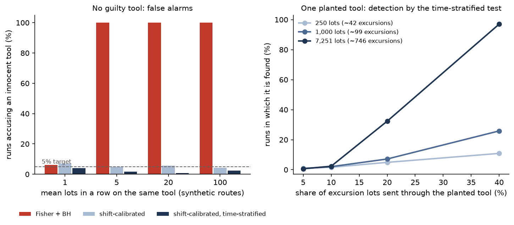

# 机台共性分析:方法在这份数据上会不会误报?

[← 返回 README](../README.zh-CN.md) · [English](en/commonality.md)

共性分析要回答的是:问题批次是不是比正常批次更多地经过了某一台机台。WM-811K 没有机台记录,所以这一步不能在真实数据上做。能检验的是方法本身(`wafermap/commonality.py`):

- 批次的结果是真实的:7,251 个首次测试批次里哪些是 excursion,按文件里的顺序排列,并把这个顺序当作时间顺序(这是假设,数据集没有时间戳)。
- **机台路径是合成的**:每个批次在 10 个工序各随机分到 4 台机台中的一台,共 40 台。
- 需要"有问题的机台"时,把一部分真实的 excursion 批次改派到指定机台。答案已知,所以能统计误报和漏报。

下面的数字说明的是检验方法在真实的结果分布上表现如何,不说明 WM-811K 里的 excursion 是哪台机台造成的。

先看到的一点是 excursion 在顺序上高度集中:746 个里有 653 个落在 3 段连续的批次里(长度 295、265、93),一个批次是 excursion 时,下一个也是的概率是平均水平的 8.9 倍。所以"746 个 excursion"更接近 3 次大事件加上约 90 个零散批次。这 3 段是真实的工艺事件,还是数据集整理方式造成的,从数据里无法判断。

比较三种检验,显著性水平都是 5%,每种设置跑 300 次:

- Fisher:对每台机台做单侧 Fisher 精确检验,再用 Benjamini-Hochberg 校正多重比较。它假设批次之间相互独立。
- 平移校准:统计量相同,但零假设的分布来自把结果序列相对机台序列做循环平移,每次平移取 40 台机台里最大的统计量。平移保留了两条序列各自的连续性。
- 平移校准 + 时间分层:只在同一段时间内(每 20 个批次一段)比较问题批次和正常批次。

没有任何机台有问题时,至少冤枉一台机台的比例:

| 同一台机台平均连续跑的批次数 | Fisher | 平移校准 | 平移校准 + 时间分层 |
|---|---|---|---|
| 1(每批独立分配) | 6% | 7% | 4% |
| 5 | **100%** | 5% | 2% |
| 20 | **100%** | 6% | 1% |
| 100 | **100%** | 4% | 2% |

只要机台不是逐批独立分配的,Fisher 检验每次都会冤枉机台。原因是问题批次连在一起、机台也连续跑货,两者碰巧重合的机会远大于独立假设下的估计。

植入一台问题机台后的检出率(用全部 7,251 个批次)。"强度"是被改派到这台机台的 excursion 批次比例,20% 相当于它在问题批次里的占比从 25% 升到 40%:

| 机台分配 | 检验 | 强度 5% | 10% | 20% | 40% |
|---|---|---|---|---|---|
| 逐批独立 | Fisher | 19% | 95% | 100% | 100% |
| 逐批独立 | 平移校准 | 22% | 93% | 100% | 100% |
| 逐批独立 | 时间分层 | 1% | 5% | 38% | 99% |
| 平均连续 20 批 | 平移校准 | 0% | 1% | 3% | 33% |
| 平均连续 20 批 | 时间分层 | 1% | 2% | 32% | 97% |

- 机台逐批独立分配时,Fisher 和平移校准一样好,时间分层反而弱,因为它放弃了不同时间段之间的对比。
- 机台连续跑货时,Fisher 不能用(检出率看起来高,但 100% 的运行里同时冤枉了别的机台);不分层的平移校准误报受控但几乎检不出;时间分层在强度 40% 时能恢复到 97%。
- 样本量的影响很大:只取连续 1,000 个批次(约 99 个 excursion)时,最好的情况检出率也只有 40%;取 250 个批次时不超过 27%。
- 两个工序之间有固定搭配时分不清是谁的问题:强度 20%、逐批独立分配,问题机台在下一工序的固定搭档有 50% 的批次跟着它走时,Fisher 在 96% 的运行里把搭档也判为有问题。这是共性分析本身的限制,要靠工艺知识或分片实验来区分。

这项分析的限制:

- 植入的问题是"零散的问题批次更多地经过这台机台"。真实的机台故障更常见的表现是一整段连续的问题批次,而这正是时间分层丢掉的信息,不分层的检验又无法把它和巧合分开。对这 3 段连续的 excursion,能用的独立证据只有 3 次,只靠批次统计定不了机台,需要维护记录、腔体信息或 inline 数据。
- 时间分层的段长是需要选的参数。默认的 20 是在 20、50、200 三个值里试出来的,之后补扫了 10:机台连续 20 批、强度 20% 时,段长 10 / 20 / 50 / 200 的检出率是 75% / 32% / 9% / 0%,误报都不超过 4%。段长应当短于机台连续跑货的长度。
- 合成路径只有 10 个工序、40 台机台。真实产线有几百个工序,多重比较的负担更重,检出率会更低。
