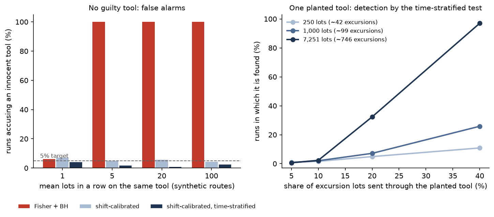

# Tool commonality: would the method raise false alarms on this data?

[← Back to README](../../README.md) · [中文](../commonality.md)

Commonality analysis asks whether problem lots went through one tool more often than normal lots did. WM-811K has no tool history, so this step cannot be done on the real data. What can be checked is the method itself (`wafermap/commonality.py`):

- The lot outcomes are real: which of the 7,251 first-test lots are excursions, in file order, with that order taken as time order (an assumption; the dataset has no timestamps).
- **The tool routes are synthetic**: at each of 10 process steps every lot is randomly assigned one of 4 tools, 40 tools in all.
- When a "problem tool" is needed, a share of the real excursion lots is reassigned to a chosen tool. The answer is known, so false alarms and misses can be counted.

The numbers below describe how the tests behave on a real distribution of outcomes. They say nothing about which tool caused the excursions in WM-811K.

The first thing to notice is how clustered the excursions are in sequence: 653 of the 746 fall in 3 runs of consecutive lots (295, 265 and 93 lots long), and a lot following an excursion is 8.9 times more likely than average to be one too. So "746 excursions" is closer to 3 large events plus about 90 isolated lots. Whether the 3 runs are real process events or an artefact of how the dataset was compiled cannot be told from the data.

Three tests are compared, all at the 5% level, with 300 runs per setting:

- Fisher: a one-sided Fisher exact test per tool, with Benjamini-Hochberg correction for multiple comparisons. It assumes lots are independent.
- Shift-calibrated: the same statistic, but its null distribution comes from circularly shifting the outcome sequence against the tool sequence, taking the largest statistic over all 40 tools at each shift. Shifting keeps the runs in both sequences.
- Shift-calibrated and time-stratified: problem lots and normal lots are compared only within the same stretch of time (20 lots per stretch).

With no problem tool at all, the share of runs that accuse at least one innocent tool:

| Mean lots in a row on the same tool | Fisher | Shift-calibrated | Shift-calibrated + time-stratified |
|---|---|---|---|
| 1 (each lot assigned independently) | 6% | 7% | 4% |
| 5 | **100%** | 5% | 2% |
| 20 | **100%** | 6% | 1% |
| 100 | **100%** | 4% | 2% |

As soon as tools are not assigned lot by lot, the Fisher test accuses innocent tools every time. Problem lots come in runs and tools process lots in campaigns, so the two overlap by chance far more often than independence predicts.

Detection with one planted problem tool (all 7,251 lots). "Strength" is the share of excursion lots reassigned to that tool; 20% raises its share of problem lots from 25% to 40%:

| Tool assignment | Test | Strength 5% | 10% | 20% | 40% |
|---|---|---|---|---|---|
| Lot by lot | Fisher | 19% | 95% | 100% | 100% |
| Lot by lot | Shift-calibrated | 22% | 93% | 100% | 100% |
| Lot by lot | Time-stratified | 1% | 5% | 38% | 99% |
| 20 lots in a row on average | Shift-calibrated | 0% | 1% | 3% | 33% |
| 20 lots in a row on average | Time-stratified | 1% | 2% | 32% | 97% |

- With lot-by-lot assignment, Fisher and the shift-calibrated test do equally well, and the time-stratified test is weaker because it gives up comparisons between stretches of time.
- When tools run lots in campaigns, Fisher cannot be used (its detection looks high, but in 100% of runs it also accuses other tools); the unstratified shift-calibrated test keeps false alarms down but detects almost nothing; the time-stratified test recovers to 97% at strength 40%.
- Sample size matters a lot: with only 1,000 consecutive lots (about 99 excursions) the best detection is 40%; with 250 lots it is at most 27%.
- When two steps have dedicated pairings, the tests cannot tell which tool is at fault: at strength 20% with lot-by-lot assignment, if the problem tool's partner at the next step follows it for 50% of lots, Fisher also flags the partner in 96% of runs. This is a limit of commonality analysis itself, and it takes process knowledge or a split-lot experiment to resolve.

Limitations of this analysis:

- The planted problem is "scattered problem lots go through this tool more often". A real tool failure more often shows up as a solid run of problem lots, which is exactly the information the time-stratified test discards, while the unstratified tests cannot tell it apart from coincidence. For the 3 runs of excursions there are only 3 independent pieces of evidence; lot statistics alone cannot pin them on a tool, and maintenance logs, chamber information or inline data would be needed.
- The stretch length of the time-stratified test is a parameter that has to be chosen. The default of 20 was picked from 20, 50 and 200, and 10 was swept afterwards: with tools running 20 lots in a row and strength 20%, stretch lengths of 10 / 20 / 50 / 200 detect the tool in 75% / 32% / 9% / 0% of runs, all with false alarms at or below 4%. The stretch should be shorter than the tools' campaigns.
- The synthetic routes have only 10 steps and 40 tools. A real fab has hundreds of steps, so the multiple-comparison burden is heavier and detection would be lower.
