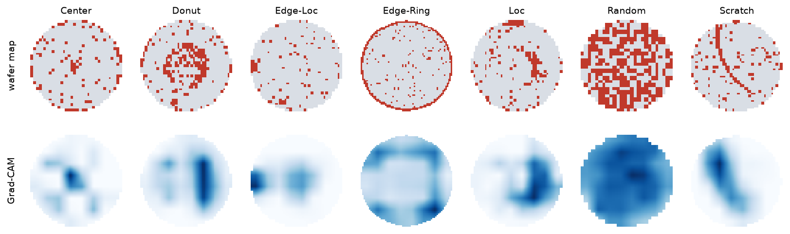
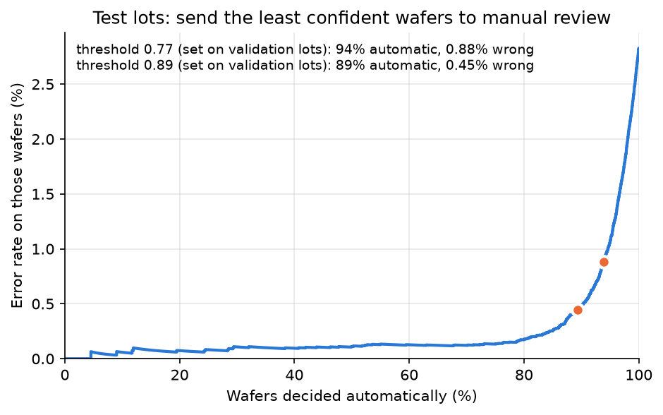
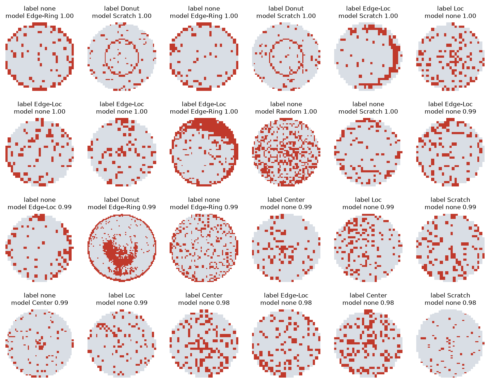

# CNN diagnostics: class weights, Grad-CAM, manual review, confident errors

[← Back to README](../../README.md) · [中文](../model-diagnostics.md)

## Effect of class weights on the CNN

Each class's weight in the loss is (inverse class frequency)^power. The CNN holds out 20% of the training lots as a validation set to pick the best epoch; the test set plays no part in tuning.

| Weight power | Seeds | Test macro-F1 | Macro precision | Macro recall |
|---|---|---|---|---|
| 0 (no weighting) | 5 | 0.856 ± 0.008 | 0.89 | 0.83 |
| 0.5 (square root) | 5 | 0.854 ± 0.005 | 0.84 | 0.87 |
| 1 (full inverse frequency) | 5 | 0.781 ± 0.019 | 0.73 | 0.87 |

- At power 1 a Near-full wafer weighs about 1,000 times as much as a `none` wafer, and the model labels many `none` wafers as rare classes. Scratch precision averages only 0.41 (between 0.30 and 0.58 across the 5 seeds; 0.74 at power 0.5). Power 1 is worse than 0.5 on all 5 seeds, by 0.073 ± 0.023 paired by seed, and its spread across seeds is 2 to 4 times that of the other two settings.
- Powers 0 and 0.5 do not differ in macro-F1: the paired difference is −0.002 ± 0.006, and 0.5 is higher on only 2 of 5 seeds. The trade-off between them is stable, though: on every seed 0.5 has higher recall and lower precision. The default is 0.5, because missing a defect pattern usually costs more than a false alarm.
- A single run would have misled: seed 0 at power 0.5 scores 0.861, 0.007 above the 5-seed mean, just enough to make it look better than power 0.
- Cosine learning-rate decay and picking the epoch on the validation set also help: in a comparison made before deduplication, power 1 scored 0.659 without them and 0.798 with them.

## Where the model looks (Grad-CAM)

Grad-CAM on correctly classified defect wafers in the test set (last convolutional layer, 8×8, upsampled to 64×64). One random wafer per class:

To go beyond looking at pictures, a "focus ratio" is defined: the share of the model's attention that falls on failing dies, divided by the share of the wafer area those dies cover. A ratio of 1 means the attention is spread evenly and ignores where the fails are.

| Class | Wafers | Median focus ratio | Share above 1 |
|---|---|---|---|
| Edge-Loc | 804 | 1.67 | 97% |
| Scratch | 177 | 1.58 | 98% |
| Loc | 470 | 1.32 | 84% |
| Donut | 96 | 1.30 | 93% |
| Center | 496 | 1.17 | 86% |
| Edge-Ring | 1,874 | 1.03 | 75% |
| Random | 155 | 1.02 | 72% |

For local patterns (Edge-Loc, Scratch, Loc) the attention clearly concentrates on the failing dies. Edge-Ring and Random sit near 1 because of a limit of the measure itself: their failing dies cover a whole ring or the whole wafer, so even a concentrated attention map cannot score much higher.

## Sending low-confidence wafers to manual review

A fab does not need the model to decide every wafer; the uncertain ones can go to an engineer. The threshold is picked on validation lots and then checked on the test set:

| Approach | Decided automatically | Error rate on those wafers | macro-F1 |
|---|---|---|---|
| Decide every wafer | 100% | 2.8% | 0.854 ± 0.005 |
| Threshold for ≤ 1% error on validation (about 0.77) | 94.4% ± 0.7% | 0.91% ± 0.12% | 0.938 ± 0.008 |
| Threshold for ≤ 0.5% error on validation (about 0.88) | 90.5% ± 1.1% | 0.45% ± 0.08% | 0.960 ± 0.007 |

Mean ± standard deviation over 5 seeds. The targets set on validation lots largely hold on the test set. The figure is seed 0.

Review mostly gets the hard classes: on seed 0 with a threshold of 0.89, 62% of Loc, 49% of Scratch and 47% of Edge-Loc go to an engineer, against 5% of Edge-Ring and 8% of `none`.

## Confident errors

Of the 965 errors on seed 0, only 126 (13%) have a confidence of 0.9 or more (12% averaged over 5 seeds); the rest would be sent to review by the threshold above. The 24 most confident of the 126:

I looked at each of them at the original resolution (these wafers are only about 25×27 to 40×40 dies, so resizing to 64×64 enlarges them and loses no pattern). What follows is a judgement call:

- About half show no sign of the labeled pattern, or look more like the class the model predicted, for example wafers labeled `none` with a ring of fails around the edge. These are more likely labeling problems.
- About 5 are a mix of two patterns, for example a cluster in the centre and a ring at the edge.
- About 5 are clear model errors, for example two thin ring-shaped Donut wafers predicted as Scratch.

So macro-F1 alone understates the model: some of its "errors" are problems with the labels. This is an eyeball check of 24 wafers, though; the test set was not relabeled.
