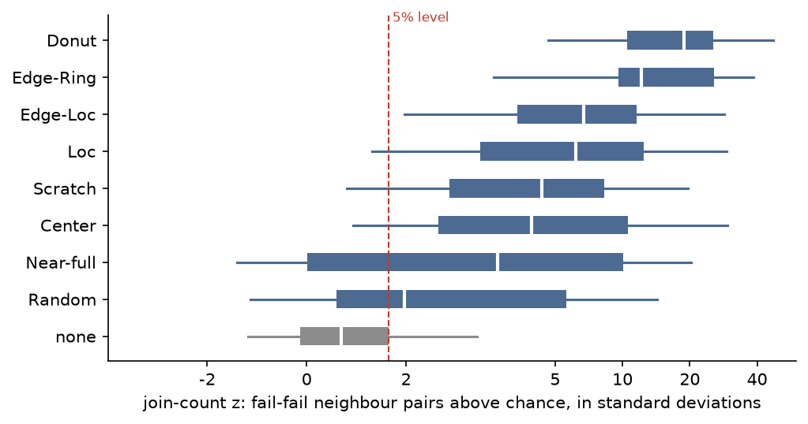

# Is "systematic" backed by statistics? (join-count test)

[← Back to README](../../README.md) · [中文](../spatial-test.md)

The yield loss split in the README uses a rule: 5 or more connected failing dies count as systematic. The rule has no error rate; on a wafer with many fails, 5 connected fails can occur by chance. So each wafer was also tested with the join-count statistic from spatial statistics (`wafermap/spatial.py`): count the pairs of neighbouring dies that both fail, and compare with the expectation if the same number of fails fell on the wafer at random, giving a z-score. The expectation and variance have closed forms, so no simulation is needed; I checked by simulation that under random placement z has mean 0 and standard deviation 1.

Share of wafers with z above 1.645 (one-sided 5%), by engineer label:

| Label | Wafers | Join-count test significant | 5 or more connected fails (old rule) |
|---|---|---|---|
| Donut | 550 | 100% | 100% |
| Edge-Ring | 9,595 | 99% | 100% |
| Edge-Loc | 4,893 | 97% | 100% |
| Loc | 3,304 | 93% | 100% |
| Center | 2,753 | 89% | 100% |
| Scratch | 1,174 | 88% | 100% |
| Near-full | 149 | 59% | 100% |
| Random | 836 | 56% | 100% |
| none | 147,430 | **25%** | **71%** |

- **The old rule also fires on 71% of `none` wafers**, and 19% of the failing dies on those wafers are counted as systematic. The join-count test is significant on 25% of `none` wafers and on 94% of patterned wafers overall.
- So "3.6% systematic loss" is overstated: 1.1 points of it are on wafers whose clustering is not significant, where the connected fails cannot be told apart from chance. Split by the test, 4.9% of the 10.1% loss is on wafers with significant clustering and 5.2% on the rest. The two splits are defined differently (by die and by wafer), so they cannot be subtracted directly.
- 25% of `none` wafers are significant, not the nominal 5%. A good share of wafers labeled "no pattern" do not have uniformly random fails. Raising the threshold to z > 5 leaves 1.3% of `none` wafers and 72% of patterned ones.
- Part of the reason is a radial gradient: the fail rate rises from centre to edge, which is not a pattern but is not uniformly random either. With the null changed to "shuffle fails only within rings of equal radius" (at most 3,000 wafers per class, 200 shuffles each), significant `none` wafers drop from 25% to 15%. The price is that radial patterns are absorbed into the null as well: Center drops from 89% to 48%, Edge-Ring from 99% to 75%.
- Low rates for Random and Near-full are expected: Random wafers have dense but random fails, and Near-full wafers fail almost entirely, leaving nothing to cluster. These classes have to be recognised by fail rate, not by clustering.
- As a score for "pattern / no pattern", z has an AUC of 0.951 and the old rule's "share of fails in clusters" 0.948, almost the same (the fail rate alone gives 0.734). The benefit of the join-count test is not better ranking but a threshold with a statistical meaning instead of a hand-picked "5".

Limitations:

- The test's sensitivity grows with the number of dies. Split into three groups by die count, the significant share of `none` wafers is 12% / 28% / 39%, so significant shares cannot be compared directly between products.
- Unlabeled first-test wafers (453,269) are 53% significant, with 18.5% above z = 5, but their median die count is twice that of labeled wafers (1,513 against 793). How much of the difference comes from die count and how much from genuinely more patterns cannot be separated here.
- Each of 620k wafers is tested once and the 5% threshold is not corrected for multiple testing; it is used to compare shares between groups, not to draw conclusions about single wafers.
