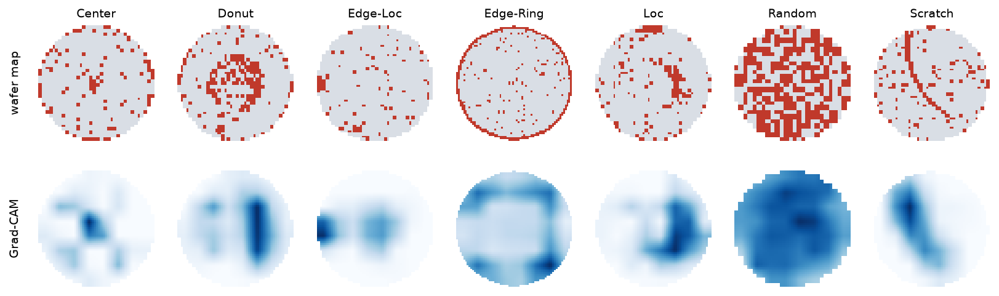
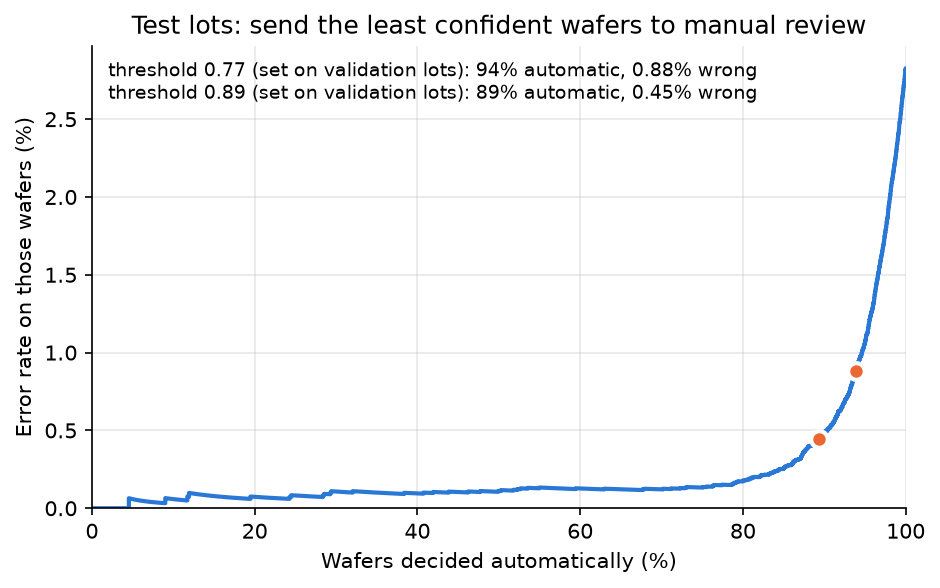
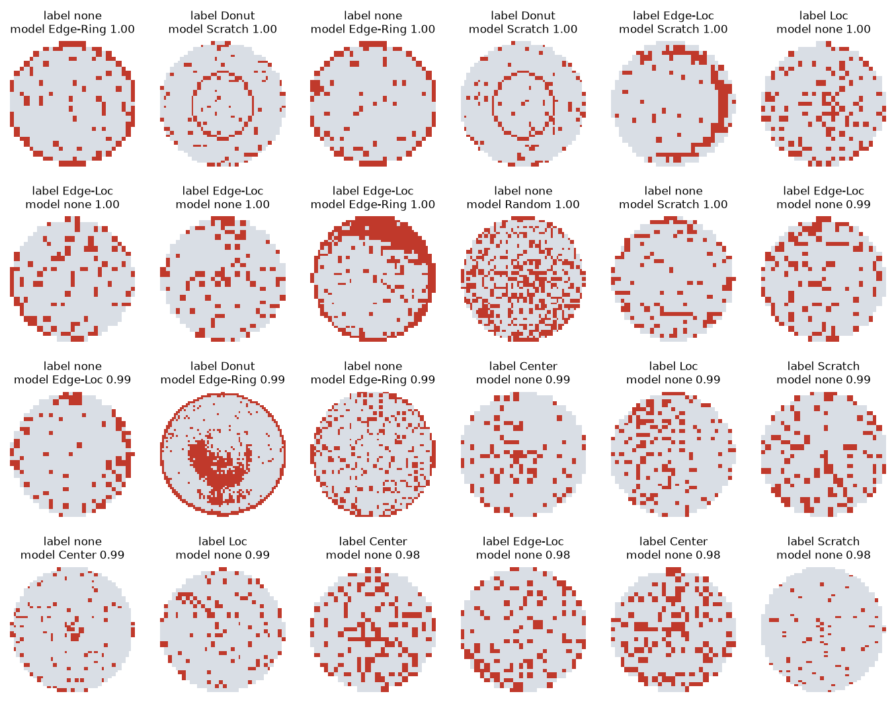

# CNN 的诊断:类别权重、Grad-CAM、转人工、高置信度错例

[← 返回 README](../README.md)

## 类别权重对 CNN 的影响

损失函数里每类的权重是(类别频率的倒数)^强度。CNN 从训练 lot 里再分出 20% 作验证集选最佳 epoch,测试集不参与调参。

| 权重强度 | 种子数 | 测试集 macro-F1 | 宏平均精确率 | 宏平均召回率 |
|---|---|---|---|---|
| 0(不加权) | 5 | 0.856 ± 0.008 | 0.89 | 0.83 |
| 0.5(平方根) | 5 | 0.854 ± 0.005 | 0.84 | 0.87 |
| 1(完全按频率倒数) | 5 | 0.781 ± 0.019 | 0.73 | 0.87 |

- 强度 1 时一片 Near-full 的权重约是一片 `none` 的 1000 倍,模型把大量 `none` 误判成稀有类,Scratch 的精确率平均只有 0.41(5 个种子在 0.30 – 0.58 之间;强度 0.5 时是 0.74)。它在 5 个种子上都比强度 0.5 差,逐种子配对相差 −0.073 ± 0.023,而且种子之间的波动是另外两个配置的 2 到 4 倍。
- 强度 0 和 0.5 的 macro-F1 没有差别:逐种子配对相差 −0.002 ± 0.006,5 个种子里 0.5 只在 2 个上更高。但两者的取舍很稳定,0.5 在每个种子上都是召回率更高、精确率更低。默认取 0.5,因为漏判缺陷图案的代价通常比误报大。
- 只跑一次会误导:种子 0 的强度 0.5 得到 0.861,比 5 次平均高 0.007,刚好让它看起来比强度 0 好。
- 余弦学习率衰减和用验证集选 epoch 也有帮助:去重之前的一次对比里,同样是强度 1,不用这两项时是 0.659,用了之后是 0.798。

## 模型看的是哪里(Grad-CAM)

对测试集里分类正确的缺陷晶圆计算 Grad-CAM(取最后一个卷积层,8×8,再放大到 64×64)。每个类别随机抽一片:

为了不只靠看图,定义了一个"聚焦倍数":模型注意力落在失效 die 上的比例,除以失效 die 占晶圆面积的比例。等于 1 表示注意力均匀铺开,和失效位置无关。

| 类别 | 晶圆数 | 聚焦倍数中位数 | 大于 1 的比例 |
|---|---|---|---|
| Edge-Loc | 804 | 1.67 | 97% |
| Scratch | 177 | 1.58 | 98% |
| Loc | 470 | 1.32 | 84% |
| Donut | 96 | 1.30 | 93% |
| Center | 496 | 1.17 | 86% |
| Edge-Ring | 1,874 | 1.03 | 75% |
| Random | 155 | 1.02 | 72% |

局部图案(Edge-Loc、Scratch、Loc)的注意力明显集中在失效 die 上。Edge-Ring 和 Random 接近 1 是这个指标本身的限制:它们的失效 die 铺满整圈或整片晶圆,注意力再集中也高不了多少。

## 置信度低的晶圆转人工

产线上不需要模型对每片晶圆都下结论,可以把没把握的交给工程师。阈值在验证集 lot 上选定,再到测试集上检查:

| 做法 | 自动判定的比例 | 这些晶圆的错误率 | macro-F1 |
|---|---|---|---|
| 全部自动判定 | 100% | 2.8% | 0.854 ± 0.005 |
| 验证集上错误率 ≤ 1% 的阈值(约 0.77) | 94.4% ± 0.7% | 0.91% ± 0.12% | 0.938 ± 0.008 |
| 验证集上错误率 ≤ 0.5% 的阈值(约 0.88) | 90.5% ± 1.1% | 0.45% ± 0.08% | 0.960 ± 0.007 |

数字是 5 个种子的均值 ± 标准差。阈值在验证集上定的目标,在测试集上基本兑现了。图是种子 0。

转人工的主要是难分的类别:种子 0 用阈值 0.89 时,Loc 有 62%、Scratch 49%、Edge-Loc 47% 交给人工,Edge-Ring 只有 5%,`none` 8%。

## 置信度很高的错例

种子 0 的 965 个错例里只有 126 个(13%)的置信度在 0.9 以上(5 个种子平均 12%),其余的都会被转人工的阈值交给人工。把这 126 个按置信度排序,前 24 个如下:

我逐张看了它们的原始分辨率晶圆图(这些晶圆原本只有 25×27 到 40×40 左右,缩放到 64×64 是放大,不会丢掉图案)。以下是主观判断:

- 约一半在原图上看不出标注的图案,或者更像模型给出的类别,例如标注为 `none` 但边缘一圈失效的晶圆。这部分更可能是标注问题。
- 约 5 张是两种图案的混合,例如中心有一团失效、边缘又有一圈。
- 明确是模型判错的约 5 张,例如两张细环状的 Donut 被判成 Scratch。

所以单看 macro-F1 会低估模型:一部分"错误"其实是标注本身有问题。不过这只是 24 张的目测,没有重新标注整个测试集。
