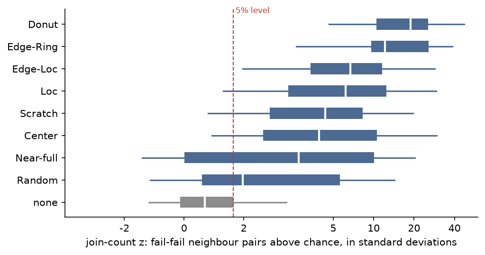

# "系统性"的判断有没有统计依据?(join-count 检验)

[← 返回 README](../README.md)

README 里的良率损失拆分用的是一条规则:5 个以上相连的失效 die 算系统性。它没有误判率的概念,失效多的晶圆上,5 个相连的失效靠巧合也会出现。所以另外用空间统计里的 join-count 检验对每片晶圆做了一次(`wafermap/spatial.py`):数一数相邻且都失效的 die 对有多少,和"同样数量的失效随机落在这片晶圆上"时的期望比较,得到一个 z 值。期望和方差有解析公式,不需要模拟;我用模拟核对过,随机落点时 z 的均值是 0、标准差是 1。

按人工标注分组,z 超过 1.645(单侧 5%)的晶圆比例:

| 标注 | 晶圆数 | join-count 检验显著 | 有 5 个以上相连的失效(原规则) |
|---|---|---|---|
| Donut | 550 | 100% | 100% |
| Edge-Ring | 9,595 | 99% | 100% |
| Edge-Loc | 4,893 | 97% | 100% |
| Loc | 3,304 | 93% | 100% |
| Center | 2,753 | 89% | 100% |
| Scratch | 1,174 | 88% | 100% |
| Near-full | 149 | 59% | 100% |
| Random | 836 | 56% | 100% |
| none | 147,430 | **25%** | **71%** |

- **原规则在 71% 的 `none` 晶圆上也会触发**,这些晶圆 19% 的失效 die 被算成了系统性。join-count 检验在 `none` 上是 25%,有图案的晶圆整体是 94%。
- 所以"系统性损失 3.6%"偏高:其中 1.1 个百分点落在聚集性不显著的晶圆上,这部分相连的失效和巧合没有区别。按检验来分,10.1% 的损失里 4.9% 在聚集性显著的晶圆上,5.2% 在不显著的晶圆上。两种拆法的口径不同(一个按 die,一个按晶圆),不能直接相减。
- `none` 晶圆的显著比例是 25%,不是名义上的 5%。也就是说标成"无图案"的晶圆里,有相当一部分的失效并不是均匀随机的。把 z 的门槛提到 5,`none` 只剩 1.3%,有图案的晶圆还有 72%。
- 一部分原因是径向梯度:失效率从中心到边缘逐渐升高,不算图案,但也不是均匀随机。把零假设改成"只在同一半径的环内打乱失效位置"(每类最多抽 3,000 片,每片打乱 200 次),`none` 的显著比例从 25% 降到 15%;代价是径向的图案也被吸收进零假设,Center 从 89% 降到 48%,Edge-Ring 从 99% 降到 75%。
- Random 和 Near-full 的显著比例低是合理的:Random 类本来就是密集但随机的失效;Near-full 几乎整片失效,没有聚集可言。这两类要靠失效率来识别,不能靠聚集性。
- 作为区分"有图案 / 无图案"的排序指标,z 值的 AUC 是 0.951,原规则的"成团失效占比"是 0.948,两者几乎一样(只用失效率是 0.734)。join-count 的好处不在排序更准,而在门槛有统计含义,不用手定"5 个"。

限制:

- 检验的灵敏度随 die 数增加。`none` 晶圆按 die 数分三组,显著比例是 12% / 28% / 39%。所以不同产品之间的显著比例不能直接比较。
- 没有标注的首次测试晶圆(453,269 片)有 53% 显著、18.5% 的 z 超过 5,但它们的 die 数中位数是有标注晶圆的两倍(1,513 对 793),这个差别有多少来自 die 数、多少来自确实有更多图案,这里分不开。
- 62 万片晶圆各做一次检验,5% 的门槛没有做多重比较校正;这里用它来比较各组的比例,不用来对单片晶圆下结论。
